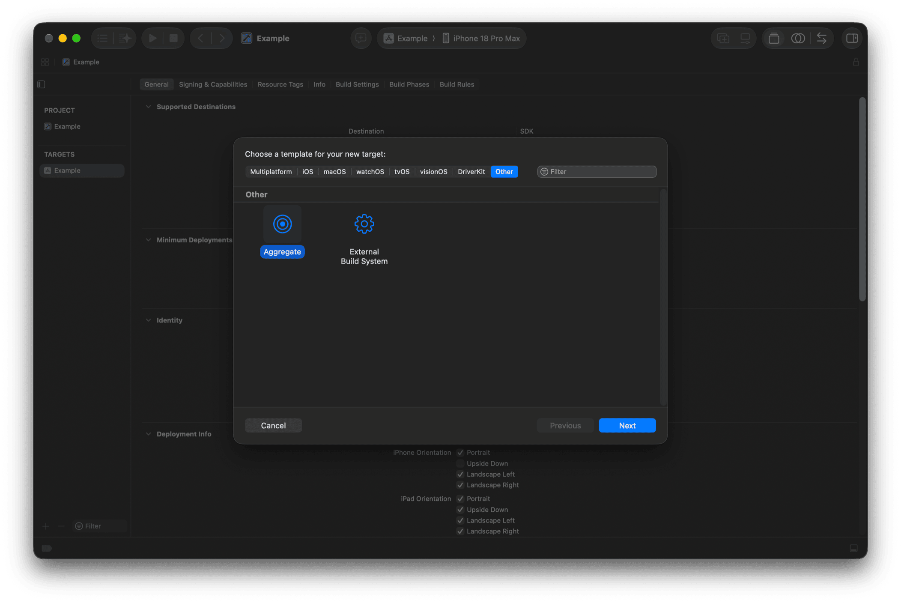
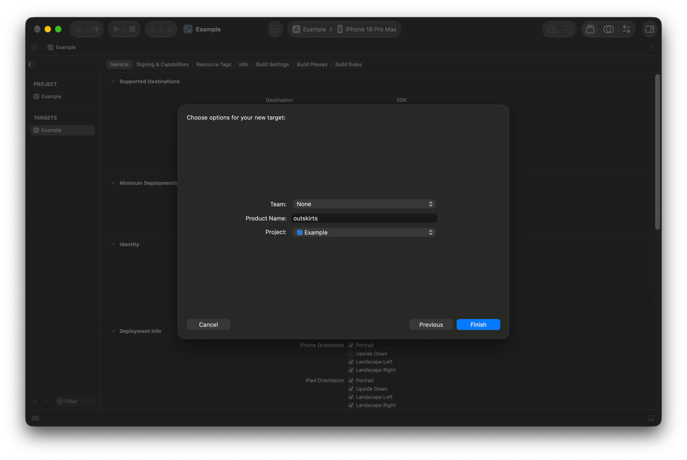
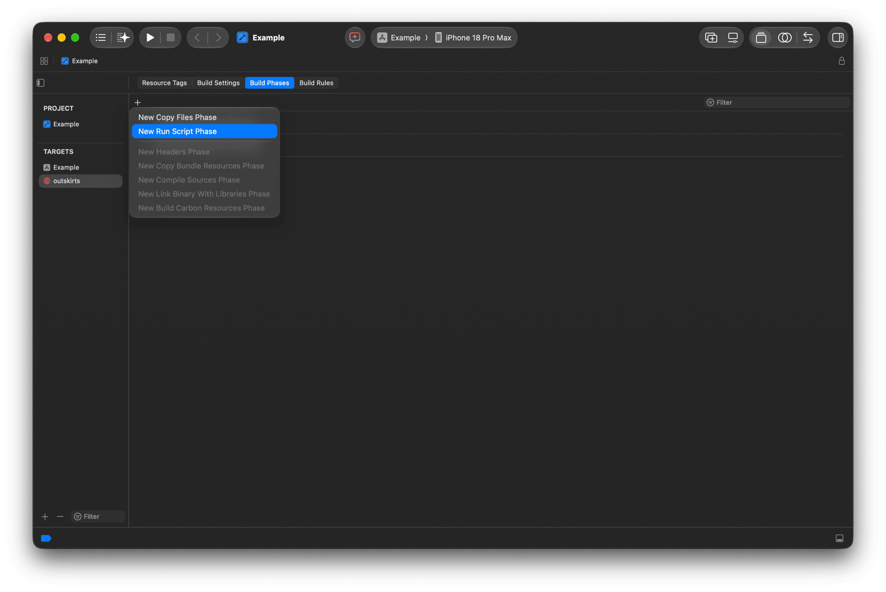
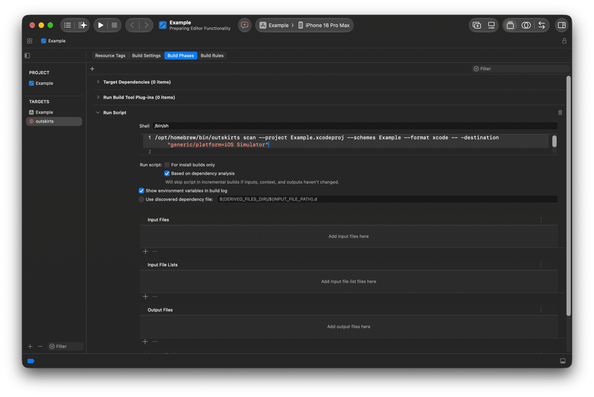
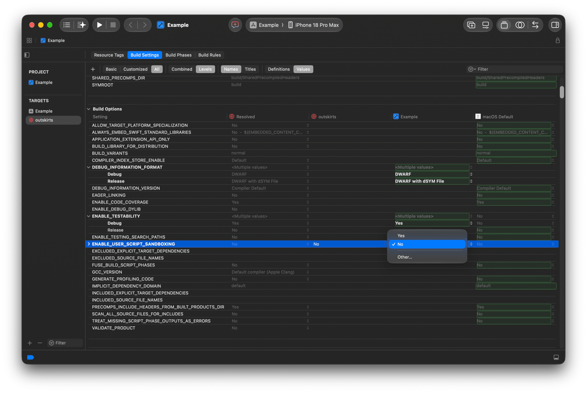
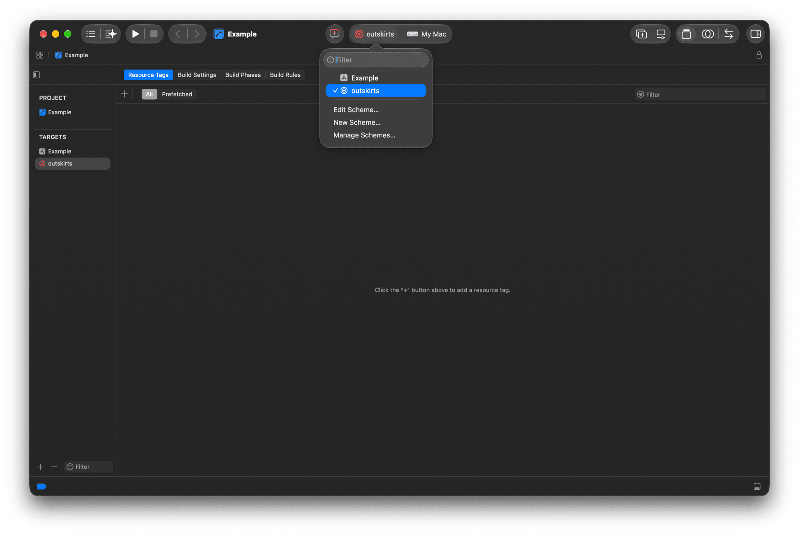

<h1 align="center">Periphery</h1>

<h4 align="center">A tool to identify unused code in Swift projects.</h4>

<p align="center">
<a href="https://github.com/tiny-earth-moon/periphery/releases/latest">
</a>

<br>
<br>
</p>

> [!NOTE]
>
> This is the community-maintained successor of [peripheryapp/periphery](https://github.com/peripheryapp/periphery), archived in August 2026. It continues the open-source 3.x line with bug fixes, support for current Xcode/Swift toolchains and new features.
>
> Install with `brew install tiny-earth-moon/tap/periphery` (a prebuilt bottle is available, see [Installation](#installation)) or build from source. Versions and changes: [CHANGELOG.md](CHANGELOG.md) and the [releases page](https://github.com/tiny-earth-moon/periphery/releases). Issues and pull requests: this repository, see [CONTRIBUTING.md](CONTRIBUTING.md).
>
> Periphery was created by [Ian Leitch](https://github.com/ileitch), whom we thank for years of excellent work and for keeping the project open source. See [Credits](#credits) for the full attribution, including the sibling fork [agoodkind/periphery](https://github.com/agoodkind/periphery).
>
> The original author now develops [Periphery Pro](https://periphery.pro), a separate closed-source product. This fork takes nothing from it; both install a `periphery` executable, so install one or the other (the Homebrew formulae conflict on purpose). This fork is not affiliated with, nor endorsed by, the original author or Periphery Pro. The `periphery` name is kept for the executable and the configuration file for compatibility; it is not a claim on the Periphery brand.

## Contents

- [Installation](#installation)
- [How To Use](#how-to-use)
    - [The `scan` Command](#the-scan-command)
    - [Configuration](#configuration)
- [Analysis](#analysis)
    - [Function Parameters](#function-parameters)
    - [Generic Type Parameters](#generic-type-parameters)
    - [Protocols](#protocols-1)
    - [Enumerations](#enumerations)
    - [Assign-only Properties](#assign-only-properties)
    - [Unassigned Optional Analysis](#unassigned-optional-analysis)
    - [Redundant Public Accessibility](#redundant-public-accessibility)
    - [Open / Final Analysis](#open--final-analysis)
    - [Redundant Access Level Analysis](#redundant-access-level-analysis)
    - [Empty Extension Analysis](#empty-extension-analysis)
    - [Unused Imports](#unused-imports)
    - [Platform Conditionals](#platform-conditionals)
    - [Objective-C](#objective-c)
    - [JavaScriptCore](#javascriptcore)
    - [Codable](#codable)
    - [Equatable and Hashable](#equatable-and-hashable)
    - [Retaining by Attribute](#retaining-by-attribute)
    - [Unused Parameters Without a Default Value](#unused-parameters-without-a-default-value)
    - [XCTestCase](#xctestcase)
    - [Interface Builder](#interface-builder)
    - [Asset Catalog Colors](#asset-catalog-colors)
    - [Asset Catalog Images](#asset-catalog-images)
    - [SPI (System Programming Interface)](#spi-system-programming-interface)
    - [Localized Strings](#localized-strings)
- [Comment Commands](#comment-commands)
- [Xcode Integration](#xcode-integration)
- [Excluding Files](#excluding-files)
- [Continuous Integration](#continuous-integration)
- [Build Systems](#build-systems)
- [Platforms](#platforms)
- [Troubleshooting](#troubleshooting)
- [Known Bugs](#known-bugs)
- [Credits](#credits)

## Installation

### [Homebrew](https://brew.sh/)

```sh
brew install tiny-earth-moon/tap/periphery
```

On Apple silicon with macOS 27 or later, Homebrew pours a prebuilt bottle; on other systems it builds from source. The bottle loads `libIndexStore.dylib` from `/Applications/Xcode.app`, or else from the Command Line Tools; with neither, build from source with `brew install --build-from-source tiny-earth-moon/tap/periphery`. Installing by the full name trusts the formula under Homebrew's [tap trust](https://docs.brew.sh/Tap-Trust); after `brew tap tiny-earth-moon/tap`, a short-name install needs `brew trust --formula tiny-earth-moon/tap/periphery` first.

### [Mint](https://github.com/yonaskolb/mint)

```sh
mint install tiny-earth-moon/periphery
```

### From source

```sh
git clone https://github.com/tiny-earth-moon/periphery.git
cd periphery
swift build -c release --product periphery
```

## How To Use

### The `scan` Command

The scan command is Periphery's primary function. To begin a guided setup, change to your project directory and run:

```sh
periphery scan --setup
```

The guided setup will detect your project type and configure a few options. After answering a few questions, Periphery will print out the full scan command and execute it.

The guided setup is only intended for introductory purposes. Once you are familiar with Periphery, you can try some more advanced options, all of which can be seen with `periphery help scan`.

To get the most from Periphery, it’s important to understand how it works. Periphery first builds your project; it does this to generate the “index store”. The index store contains detailed information about the declarations (class, struct, func, etc.) in your project and their references to other declarations. Using this store, Periphery builds an in-memory graph of the relational structure of your project, supplementing it with additional information obtained by parsing each source file. Next, the graph is mutated to make it more suitable for detecting unused code, e.g., marking your project’s entry points. Finally, the graph is traversed from its roots to identify unreferenced declarations.

> [!TIP]
> The index store only contains information about source files in the build targets compiled during the build phase. If a given class is only referenced in a source file that was not compiled, then Periphery will identify the class as unused. It's important to ensure you build all the targets you expect to contain references. For an Xcode project, this is controlled using the `--schemes` option. For a Swift package, all targets are built automatically.

If your project consists of one or more standalone frameworks that do not also contain some kind of application that consumes their interfaces, you need to tell Periphery to assume that all public declarations are used with the `--retain-public` option.

The results are written to stdout. With any `--format` other than `xcode`, progress and `--verbose` messages go to stderr, so stdout carries only the report, e.g. `periphery scan --format json > report.json`. `--write-results <file>` also writes the report to a file, and `--skip-stdout-results` then stops it from being printed to stdout. Interrupting a scan with Ctrl-C (`SIGINT`) or `SIGTERM` stops the running build and exits with status 130 or 143.

For projects that are mixed Objective-C & Swift, it's highly recommended you [read about the implications](#objective-c) this can have on your results.

### Configuration

Once you've settled upon the appropriate options for your project, you may wish to persist them in a YAML configuration file. The simplest way to achieve this is to run Periphery with the `--verbose` option. Near the beginning of the output, you will see the `[configuration:begin]` section with your configuration formatted as YAML below. Copy & paste the configuration into `.periphery.yml` in the root of your project folder. You can now simply run `periphery scan` and the YAML configuration will be used.

Values are checked when the file is loaded. A value that does not suit its key, such as a number for a boolean (`strict: 1`), a format that does not exist (`format: xml`) or a quoted number for an integer, is reported on stderr as `<file>: '<key>' expects a boolean, got the integer 1`, and the default is kept. A key that is not an option is reported too, with the closest option when there is one (`invalid key 'retain_pubic' (did you mean 'retain_public'?)`). The file only has to be a mapping, otherwise the scan stops with an error. Two shapes are accepted in place of the exact one: a single value for an option that takes a list (`exclude_targets: Demo` is `exclude_targets: [Demo]`), and the strings `"true"` and `"false"` for a boolean, which is also reported.

The command line takes precedence over the configuration file, which takes precedence over the defaults. An option given on the command line wins even when its value is the default (`--format xcode` over `format: json` in the file), and an option that is not given leaves the value of the file untouched. Every boolean option has a `--no-` form to switch off, for one run, what the file enables (`--no-strict`, `--no-retain-public`, `--no-quiet`...). A list given on the command line replaces the list of the file; the default `index_exclude` patterns are always kept.

## Analysis

The goal of Periphery is to report instances of unused _declarations_. A declaration is a `class`, `struct`, `protocol`, `function`, `property`, `constructor`, `enum`, `typealias`, `associatedtype`, etc. As you'd expect, Periphery can identify simple unreferenced declarations, e.g., a `class` that is no longer used anywhere in your codebase.

Periphery can also identify more advanced instances of unused code. The following section explains these in detail.

### Function Parameters

Periphery can identify unused function parameters. Instances of unused parameters can also be identified in protocols and their conforming declarations, as well as parameters in overridden methods. Both of these scenarios are explained further below.

#### Protocols

An unused parameter of a protocol function will only be reported as unused if the parameter is also unused in all implementations.

```swift
protocol Greeter {
    func greet(name: String)
    func farewell(name: String) // 'name' is unused
}

class InformalGreeter: Greeter {
    func greet(name: String) {
        print("Sup " + name + ".")
    }

    func farewell(name: String) { // 'name' is unused
      print("Cya.")
    }
}
```

> [!TIP]
> You can ignore all unused parameters from protocols and conforming functions with the `--retain-unused-protocol-func-params` option.

#### Overrides

Similar to protocols, parameters of overridden functions are only reported as unused if they're also unused in the base function and all overriding functions.

```swift
class BaseGreeter {
    func greet(name: String) {
        print("Hello.")
    }

    func farewell(name: String) { // 'name' is unused
        print("Goodbye.")
    }
}

class InformalGreeter: BaseGreeter {
    override func greet(name: String) {
        print("Sup " + name + ".")
    }

    override func farewell(name: String) { // 'name' is unused
        print("Cya.")
    }
}
```

#### Foreign Protocols & Classes

Unused parameters of protocols or classes defined in foreign modules (e.g. Foundation) are always ignored since you do not have access to modify the base function declaration.

#### fatalError Functions

Unused parameters of functions that simply call `fatalError` are also ignored. Such functions are often unimplemented required initializers in subclasses.

```swift
class Base {
    let param: String

    required init(param: String) {
        self.param = param
    }
}

class Subclass: Base {
    init(custom: String) {
        super.init(param: custom)
    }

    required init(param: String) {
        fatalError("init(param:) has not been implemented")
    }
}
```

### Generic Type Parameters

An unused generic parameter of a function or method is reported. The generic parameters of a `struct`, `class`, `enum` or `actor` are not, because a parameter that appears in no member is often deliberate: a phantom type distinguishes specializations at compile time (`Tagged<UserTag>`, typed identifiers, units, state machines), and removing it breaks every specialization. The opt-in `--report-unused-type-parameters` (`report_unused_type_parameters: true`) reports them as well:

```swift
struct Tagged<Tag> { // 'Tag' is reported only with --report-unused-type-parameters
    let raw: Int
}
```

### Protocols

A protocol that is conformed to by an object is not truly used unless it's also used as an existential type or to specialize a generic method/class. Periphery is able to identify such redundant protocols whether they are conformed to by one or even multiple objects.

```swift
protocol MyProtocol { // 'MyProtocol' is redundant
    func someMethod()
}

class MyClass1: MyProtocol { // 'MyProtocol' conformance is redundant
    func someMethod() {
        print("Hello from MyClass1!")
    }
}

class MyClass2: MyProtocol { // 'MyProtocol' conformance is redundant
    func someMethod() {
        print("Hello from MyClass2!")
    }
}

let myClass1 = MyClass1()
myClass1.someMethod()

let myClass2 = MyClass2()
myClass2.someMethod()
```

Here we can see that despite both implementations of `someMethod` being called, at no point does an object take on the type of `MyProtocol`. Therefore, the protocol itself is redundant, and there's no benefit from `MyClass1` or `MyClass2` conforming to it. We can remove `MyProtocol` along with each redundant conformance and just keep `someMethod` in each class.

Just like a normal method or property of an object, individual properties and methods declared by your protocol can also be identified as unused.

```swift
protocol MyProtocol {
    var usedProperty: String { get }
    var unusedProperty: String { get } // 'unusedProperty' is unused
}

class MyConformingClass: MyProtocol {
    var usedProperty: String = "used"
    var unusedProperty: String = "unused" // 'unusedProperty' is unused
}

class MyClass {
    let conformingClass: MyProtocol

    init() {
        conformingClass = MyConformingClass()
    }

    func perform() {
        print(conformingClass.usedProperty)
    }
}

let myClass = MyClass()
myClass.perform()
```

Here we can see that `MyProtocol` is itself used and cannot be removed. However, since `unusedProperty` is never called on `MyConformingClass`, Periphery can identify that the declaration of `unusedProperty` in `MyProtocol` is also unused and can be removed along with the unused implementation of `unusedProperty`.

### Enumerations

Along with being able to identify unused enumerations, Periphery can also identify individual unused enum cases. Plain enums that are not raw representable, i.e., that _don't_ have a `String`, `Character`, `Int`, or floating-point value type, can be reliably identified. However, enumerations that _do_ have a raw value type can be dynamic, and therefore must be assumed to be used.

Let's clear this up with a quick example:

```swift
enum MyEnum: String {
    case myCase
}

func someFunction(value: String) {
    if let myEnum = MyEnum(rawValue: value) {
        somethingImportant(myEnum)
    }
}
```

There's no direct reference to the `myCase` case, so it's reasonable to expect it _might_ no longer be needed. However, if it were removed, we can see that `somethingImportant` would never be called if `someFunction` were passed the value of `"myCase"`.

### Assign-only Properties

Properties that are assigned but never used are identified as such, e.g.:

```swift
class MyClass {
    var assignOnlyProperty: String // 'assignOnlyProperty' is assigned, but never used

    init(value: String) {
        self.assignOnlyProperty = value
    }
}
```

In some cases this may be the intended behavior; therefore, you have a few options available to silence such results:

- Retain individual properties using [Comment Commands](#comment-commands).
- Retain all assign-only properties by their type with `--retain-assign-only-property-types`. Given types must match their exact usage in the property declaration (sans optional question mark), e.g. `String`, `[String]`, `Set<String>`. Periphery is unable to resolve inferred property types, therefore in some instances, you may need to add explicit type annotations to your properties.
- Disable assign-only property analysis entirely with `--retain-assign-only-properties`.

### Unassigned Optional Analysis

The symmetric case, optional properties that are read but never assigned (and are therefore always `nil`), is reported when the opt-in `--enable-unassigned-optional-analysis` option (`enable_unassigned_optional_analysis: true`) is enabled, e.g.:

```swift
class MyClass {
    var someVar: Int? // Optional property 'someVar' is never assigned (always nil)

    func someFunc() {
        print(someVar)
    }
}
```

Only stored `var` properties declared with an optional type (`T?`, `T!`, `Optional<T>`) and no initial value other than `nil` are considered. Writes are taken from the index (assignments, `self.x = …` in closures, `inout` arguments, a writable key path used directly as `object[keyPath: \.name] = …`), so a property assigned anywhere is not reported. Properties that may be assigned in ways the index does not record are never reported: properties referenced by a key path that is stored or passed on (`\.name` as an argument or in a variable, e.g. `assign(to:on:)`), as it may be written through, properties with an attribute (`@IBOutlet`, `@NSManaged`, `@objc`, property wrappers…), `weak`, `unowned`, `dynamic`, `lazy` or `override` properties, Objective-C accessible properties, properties of types conforming to `Codable`/`Decodable` or `NSCoding`, protocol requirements, and retained properties (including [Comment Commands](#comment-commands)). Properties of structs with a synthesized memberwise initializer are considered assigned by it. Results use the `unassignedOptionalProperty` kind in `report_exclude`.

### Redundant Public Accessibility

Declarations that are marked `public` yet are not referenced from outside their home module are identified as having redundant public accessibility. In this scenario, the `public` annotation can be removed from the declaration. Removing redundant public accessibility has a couple of benefits:

- It helps reduce the public surface area of your modules.
- In [Whole Module Compilation](https://github.com/apple/swift/blob/main/docs/OptimizationTips.rst#whole-module-optimizations-wmo) mode, Swift can infer `final` by [automatically discovering](https://github.com/apple/swift/blob/main/docs/OptimizationTips.rst#advice-if-wmo-is-enabled-use-internal-when-a-declaration-does-not-need-to-be-accessed-outside-of-module) all potentially overriding declarations. `final` classes are [better optimized](https://github.com/apple/swift/blob/main/docs/OptimizationTips.rst#advice-use-final-when-you-know-the-declaration-does-not-need-to-be-overridden) by the compiler.

This analysis can be disabled with `--disable-redundant-public-analysis`.

By default, the explicit `public` members of a `public` type or extension that is itself referenced from outside its module are not checked, since it is common to publish a set of members before they are all used. The opt-in `--enable-redundant-public-members` (`enable_redundant_public_members: true`) reports those members as well: a member explicitly marked `public` (methods, initializers, properties, subscripts, nested types) that is not referenced from outside its module has redundant public accessibility, following the same rules as top-level declarations (references from files that `@testable import` the module do not count). Members of `open` classes are checked too. The following members are never reported, because their accessibility is required or their use cannot be observed:

- `open` members, overrides and `required` initializers.
- Protocol requirement implementations, including those of external protocols (`Equatable`, `CustomStringConvertible`, `Codable`…), as recorded by the index.
- `@inlinable` and `@usableFromInline` members, and members referenced from a public `@inlinable` function.
- Members of `@propertyWrapper`, `@resultBuilder` and `@dynamicMemberLookup` types.
- Implicit members (synthesized `Codable` conformance, memberwise initializers), `enum` cases, type aliases and associated types.
- Members whose type appears in another public declaration's signature.

Members that are implicitly public because their extension is marked `public` (`public extension T { func f() }`) are not reported: the modifier to remove is the extension's.

### Open / Final Analysis

This opt-in analysis, enabled with `--enable-open-final-analysis` (`enable_open_final_analysis: true`), reports two kinds of results:

- `redundantOpenAccessibility`: a class or member marked `open` that is never subclassed or overridden outside its home module, so it could be `public`. An `open` member of a class that is not itself `open` is always reported, as it cannot be overridden outside the module.
- `missingFinal`: a `public` or `internal` class that is never subclassed, or a member that is never overridden, so it could be `final`. Members of a class reported as a whole are not reported again, and constants, initializers, static members, actors and declarations already `final` are ignored. Objective-C accessible declarations are ignored with `--retain-objc-accessible`, as are `dynamic` members.

Subclasses and overrides are read from the index store, which only describes the scanned modules. A subclass or override declared by an unscanned client module cannot be observed, therefore `redundantOpenAccessibility` is only reliable when every module that uses the `open` declarations is scanned, and it is skipped entirely with `--retain-public`. Subclasses and overrides declared in files that `@testable import` the home module do not count as being outside of it, as they only need `public` accessibility.

Either kind can be excluded with `report_exclude`, e.g. `**/Generated/**:missingFinal`.

### Redundant Access Level Analysis

This opt-in analysis, enabled with `--enable-redundant-access-level-analysis` (`enable_redundant_access_level_analysis: true`), reports `redundantAccessLevel` results: explicit access modifiers identical to the access level the declaration would get without them, i.e. the default of its enclosing context. Removing such a modifier does not change the access level of the declaration. The result message names the redundant modifier and the context it repeats.

| Declaration | Context | Reported |
|-------------|---------|----------|
| `internal` declaration or extension | top level | yes |
| `fileprivate` or `private` declaration | top level | no (no enclosing modifier; both mean file scope) |
| `internal` member | `open`, `public` or `internal` type (explicit or implicit) | yes |
| `public` member | `public` or `open` type | no (members of a `public` type default to `internal`) |
| `private` or `fileprivate` member | `internal` type | no (narrower than the default) |
| `fileprivate` member | `private` or `fileprivate` top-level type, or a type nested in one without modifier | yes |
| `private` member | `private` or `fileprivate` type | no (restricts access to the type's declarations, narrower than file scope) |
| any member | `private` nested type | no (its members default to the enclosing scope, which no modifier expresses) |
| member with the extension's modifier (`public`, `internal`, `fileprivate`, `private`) | extension with that modifier | yes |
| `fileprivate` member | `private` extension | yes (members of a `private` extension are `fileprivate`) |
| `private` member | `fileprivate` extension | no (narrower than the default) |
| `internal` member | `public` extension | no |
| member | extension without modifier | like a member of the extended type; extensions of external types are treated like extensions of a `public` type |
| `open` declaration or member | any | never (see [Open / Final Analysis](#open--final-analysis)) |
| setter modifier (`private(set)`, `internal(set)`…) | any | never; only the getter modifier (`public` in `internal(set) public var`) is checked |
| protocol requirement, `enum` case | any | never (they cannot carry an access modifier) |
| member of a `package` type or extension | any | never (the `package` access level is not modelled) |

A member of a `private` extension marked `private` is reported although, strictly, it stays visible to the extended type's declarations in the file only: the extension already confines it to the file, which is the intended scope in practice. Results of unused declarations are not repeated, and results can be excluded with `report_exclude`, e.g. `**/Generated/**:redundantAccessLevel`.

### Empty Extension Analysis

This opt-in analysis, enabled with `--enable-empty-extension-analysis` (`enable_empty_extension_analysis: true`), reports `emptyExtension` results: extensions that declare neither a member nor a conformance, such as `extension Foo {}`. Removing them does not change the program. The result message reads `Empty extension of 'Foo'` and the JSON `kind` is `extension`.

| Extension | Reported |
|-----------|----------|
| `extension Foo {}`, with or without a `where` clause | yes |
| body containing only comments | yes |
| body containing only `#if` blocks whose clauses are all empty | yes |
| `@available` attribute only | yes |
| conformance (`extension Foo: Bar {}`), even with an empty body | never |
| at least one member, including in one clause of an `#if` block | never |
| any other attribute (an attached macro can add members or conformances) | never |
| preceded by `// periphery:ignore`, in a file with `// periphery:ignore:all`, or in a file matched by `retain_files` | never |

The index store has no record of an extension without members or conformances, so this analysis reads the syntax of the indexed source files instead. As a consequence, an extension is judged on its source text only: the members a macro expansion or another `#if` configuration would produce are unknown, and `// periphery:ignore` is the way to keep an extension that is empty on purpose. Results can be excluded with `report_exclude`, e.g. `**/Generated/**:emptyExtension`.

### Unused Imports

Periphery can only detect unused imports of targets it has scanned. It cannot detect unused imports of other targets because the Swift source files are unavailable and uses of `@_exported` cannot be observed. `@_exported` is problematic because it changes the public interface of a target such that the declarations exported by the target are no longer necessarily declared by the imported target. For example, the `Foundation` target exports `Dispatch`, among other targets. If any given source file imports `Foundation` and references `DispatchQueue` but no other declarations from `Foundation`, then the `Foundation` import cannot be removed as it would also make the `DispatchQueue` type unavailable. To avoid false positives, therefore, Periphery only detects unused imports of targets it has scanned.

#### System Framework Imports

By default, imports of system frameworks (`Foundation`, `UIKit`, `SwiftUI`, `Combine`, …) are not analysed. The opt-in `--enable-unused-system-imports` (`enable_unused_system_imports: true`) extends the analysis to them, using the system modules that the compiler indexes alongside your code (the `isSystem` units of the index store):

- The module declaring each referenced system declaration is read from the index store records of the system modules, and from the module name mangled into Swift USRs (`s:10Foundation3URLV`).
- Every module a system module depends on in the index store is treated as possibly re-exported by it, along with a short list of known re-exports (`Foundation` exports `Dispatch`, `Darwin`, `CoreFoundation` and `ObjectiveC`; `UIKit` and `AppKit` export `Foundation`; `SwiftUI` exports `SwiftUICore`; `Cocoa` exports `AppKit`, `Foundation` and `CoreData`). An import is therefore not reported when another imported framework may provide it, nor when the file uses a module the import may re-export: importing both `UIKit` and `Foundation` and using only `URL` reports neither.
- A file referencing any declaration whose module cannot be determined has none of its system imports analysed.
- System imports are only analysed when the index store contains the system modules. A store built without them (for example with `-index-ignore-system-modules`) reports no system import.

Limitations: uses that leave no reference in the index store are invisible, such as `@objc` or `dynamic` without any other Objective-C runtime reference, so a file whose only use of `Foundation` is an `@objc` attribute is reported. Use `// periphery:ignore` on the import, or `retain_unused_imported_modules`, for such cases.

Periphery will likely produce false positives for targets with mixed Swift and Objective-C, as Periphery cannot scan the Objective-C files. It is recommended, therefore, to disable unused import detection for projects with a significant amount of Objective-C or manually exclude the mixed language targets from the results.

### Platform Conditionals

The index store only describes the platform Periphery built for, so code that is only used on another platform would be reported as unused. To avoid these false positives, Periphery retains:

- Declarations marked `@available(<platform>, unavailable)` (e.g. `@available(tvOS, unavailable)`), along with their members. `@available(*, unavailable)`, `swift` and `*ApplicationExtension` platforms are not affected.
- Declarations whose name is written inside an `#if` block conditioned on `os()`, `targetEnvironment()`, `arch()` or `canImport()`, including its `#else` branches. Matching is done by name on the syntax tree, so unrelated declarations that share the name are retained too.
- Imports of the modules declaring a name written inside such a block, or named there. With `--enable-unused-system-imports`, a file whose blocks write a name that no scanned declaration accounts for keeps all its system imports.

This can be disabled with `--disable-platform-conditional-retention`. Other conditions, such as `#if DEBUG`, are not covered, see [Code referenced within a preprocessor macro conditional branch is unused](#code-referenced-within-a-preprocessor-macro-conditional-branch-is-unused).

### Objective-C

Periphery cannot analyze Objective-C code since types may be dynamically typed.

By default, Periphery does not assume that declarations accessible by the Objective-C runtime are in use. If your project is a mix of Swift & Objective-C, you can enable this behavior with the `--retain-objc-accessible` option. Swift declarations that are accessible by the Objective-C runtime are those that are explicitly annotated with `@objc` or `@objcMembers`, and classes that inherit `NSObject` either directly or indirectly via another class.

Alternatively, the `--retain-objc-annotated` option can be used to only retain declarations that are explicitly annotated with `@objc` or `@objcMembers`. Types that inherit `NSObject` are not retained unless they have explicit annotations. This option may uncover more unused code, but with the caveat that some of the results may be incorrect if the declaration is used in Objective-C code. To resolve these incorrect results, you must add an `@objc` annotation to the declaration.

### JavaScriptCore

Protocols that inherit `JSExport` expose their members to JavaScript, which Periphery cannot analyze. Use `--retain-js-accessible` (`retain_js_accessible` in the configuration file) to retain every protocol that inherits `JSExport`, either directly or through another protocol, together with its members and the members of the conforming types that satisfy them. `--retain-objc-accessible` does not cover a protocol that is only exposed through `JSExport` and has no `@objc` annotation; where it does retain them, it also retains all other Objective-C accessible declarations. The dedicated option keeps the report focused on JavaScript-exposed declarations.

### Codable

Swift synthesizes additional code for `Codable` types that is not visible to Periphery and can result in false positives for properties not directly referenced from non-synthesized code. If your project contains many such types, you can retain all properties on `Codable` types with `--retain-codable-properties`. Alternatively, you can retain properties only on `Encodable` types with `--retain-encodable-properties`.

If `Codable` conformance is declared by a protocol in an external module not scanned by Periphery, you can instruct Periphery to identify the protocols as `Codable` with `--external-codable-protocols "ExternalProtocol"`.

### Equatable and Hashable

Swift synthesizes additional code for `Equatable` and `Hashable` types that is not visible to Periphery and can result in false positives for properties not directly referenced from non-synthesized code. If your project contains many such types, you can retain all properties on `Equatable` types with `--retain-equatable-properties`, or all properties on `Hashable` types with `--retain-hashable-properties`. The `Equatable` option also retains properties on `Hashable` types because `Hashable` refines `Equatable`.

Properties can also be read implicitly through reflection, when a value is described by `print`, `debugPrint`, `String(describing:)`, `String(reflecting:)` or string interpolation (structs that do not provide their own description), or by `dump` (structs and classes). Use `--retain-synthesized-uses` to retain the stored properties of such types.

### Retaining by Attribute

Use `--retain-attributes` (`retain_attributes` in the configuration file) to retain every declaration that has one of the given attributes, as if it had a `// periphery:ignore` comment. Give the attribute name without the `@`, e.g. `--retain-attributes OptionGroup MainActor`. Custom attributes such as property wrappers are supported. To limit an attribute to some declaration kinds, append them after a colon: `--retain-attributes objc:function.method.instance,var.instance`. A kind matches itself and its sub-kinds, so `function` matches every function and method, and an unknown kind is a configuration error.

Some attributes are retained without configuration, because they exist for callers that the index cannot see:

- Functions with `@c`, `@_cdecl` or `@_expose`, which are exported to C or C++.
- Functions and variables with `@used` or `@section` (and their underscored forms `@_used` and `@_section`), which are kept in the binary or placed in a named section for the linker or a section reader.
- Functions with a body and `@_silgen_name`, which define the symbol they are linked under. A bodyless `@_silgen_name` or `@_extern(c)` declaration imports a symbol instead, so it is reported when unused, but its parameters are never reported: nothing could use them.
- Types and extensions with `@implementation` or `@_objcImplementation`, together with their members.
- The `dynamicallyCall(withArguments:)` and `dynamicallyCall(withKeywordArguments:)` methods that calls to a `@dynamicCallable` value are lowered to, in addition to the `subscript(dynamicMember:)` of `@dynamicMemberLookup` types.

### Unused Parameters Without a Default Value

Removing an unused parameter that has a default value rarely breaks callers, whereas removing one without a default does. Use `--retain-unused-parameters-without-default` (`retain_unused_parameters_without_default` in the configuration file) to retain unused parameters that have no default value, so that only the ones that are safe to remove are reported.

### XCTestCase

Any class that inherits `XCTestCase` is automatically retained along with its test methods. However, when a class inherits `XCTestCase` indirectly via another class, e.g., `UnitTestCase`, and that class resides in a target that isn't scanned by Periphery, you need to use the `--external-test-case-classes UnitTestCase` option to instruct Periphery to treat `UnitTestCase` as an `XCTestCase` subclass.

### Interface Builder

If your project contains Interface Builder files (such as storyboards and XIBs), Periphery will take these into account when identifying unused declarations. Periphery parses these files to identify which classes, `@IBOutlet` properties, `@IBAction` methods, and `@IBInspectable` properties are actually referenced. Only those members that are connected in the Interface Builder file will be retained. Any `@IB*` members that are declared but not connected will be reported as unused.

Files inside Xcode 16+ synchronized folders (`PBXFileSystemSynchronizedRootGroup`) are supported: they are collected per target, honouring each target's membership exceptions.

### Asset Catalog Colors

Xcode generates a Swift symbol for each color of an asset catalog (`ColorResource.accent`, `Color.accent`, `UIColor.accent`, ...) in a `GeneratedAssetSymbols.swift` file under DerivedData, which the default `--index-exclude` patterns exclude. Use `--detect-unused-asset-catalog-colors` (`detect_unused_asset_catalog_colors` in the configuration file) to index these files despite `--index-exclude` and report the colors that are never used. A color is used when any of its generated symbols is used, or when its name is referenced as a string: a string literal in the scanned Swift sources (e.g. `Color("Brand")` or `UIColor(named: "Brand")`), a named color of an Interface Builder file, or the global accent color (the `ASSETCATALOG_COMPILER_GLOBAL_ACCENT_COLOR_NAME` build setting of Xcode projects, `AccentColor` when no build setting names it). an unused color is reported once as `unusedAssetCatalogColor`, with its asset name and the `.colorset` directories found in the `*.xcassets` catalogs under the project directory (no path is given when none declares it). Every other declaration of the generated file is retained, and the file is left out of unused import analysis. Results are located in the generated file under DerivedData; the `.colorset` paths point to the asset to remove. To skip these results, use `--report-exclude "**/GeneratedAssetSymbols.swift:unusedAssetCatalogColor"`.

### Asset Catalog Images

Images are detected the same way with `--detect-unused-asset-catalog-images` (`detect_unused_asset_catalog_images` in the configuration file), independently of colors: Xcode generates `ImageResource.logo` and the `UIImage.logo` and `NSImage.logo` accessors for each image and symbol image of an asset catalog. An image is used when any of its generated symbols is used (e.g. `Image(.logo)` or `UIImage.logo`), or when its name is referenced as a string: a string literal in the scanned Swift sources (e.g. `Image("Logo")`, `UIImage(named: "Logo")` or `NSImage(named: "Logo")`), an image of an Interface Builder file (`image`, `backgroundImage`, `selectedImage`, ... attributes and `<image name="Logo">` resources), or an Info.plist value of `UILaunchScreen`'s `UIImageName`, `UIApplicationShortcutItemIconFile` or `CFBundleIconName`. App icon sets (`.appiconset`) have no generated symbol and are never reported. An unused image is reported once as `unusedAssetCatalogImage`, with its asset name and the `.imageset` or `.symbolset` directories found in the `*.xcassets` catalogs under the project directory. To skip these results, use `--report-exclude "**/GeneratedAssetSymbols.swift:unusedAssetCatalogImage"`.

Limits: an image loaded with a name built at runtime (e.g. `UIImage(named: "flag-\(code)")`), or referenced only from a file that is not scanned (a widget or app extension target outside the scanned schemes, a storyboard or Info.plist that the project driver does not collect, a SwiftPM resource bundle without generated symbols), is reported as unused. Scan every target that uses the catalog, or exclude these results with `--report-exclude`.

### SPI (System Programming Interface)

Swift's `@_spi` attribute marks declarations as pseudo-private, making them accessible only to clients that explicitly import the SPI. While these declarations are technically `public`, they're intended for internal or restricted use.

When using `--retain-public` for framework projects, all public declarations are retained, including those marked with `@_spi`. However, you may want to check for unused code within specific SPIs. The `--no-retain-spi` option allows you to specify which SPIs should be checked for unused code even when `--retain-public` is enabled.

For example, with `--retain-public --no-retain-spi Internal`, Periphery will:
- Retain regular `public` declarations
- Retain `@_spi(Testing) public` declarations (different SPI)
- **Check** `@_spi(Internal) public` declarations for unused code

This is particularly useful for internal SPIs that should be audited for unused code while still retaining the framework's public API.
### Localized Strings

Periphery can identify unused localized strings in String Catalog (`.xcstrings`) files. Catalogues are discovered from Xcode target resources (including synchronized folders), SPM target `resources` and the `xcstrings` key of a generic project configuration. This analysis can be disabled with `--disable-unused-localized-string-analysis` (or `disable_unused_localized_string_analysis: true` in `.periphery.yml`).

A key is considered used when a static string literal with the same value is:

- Passed to a parameter of type `LocalizedStringKey`, `LocalizedStringResource`, `String.LocalizationValue`, `DisplayRepresentation` or `IntentDescription` (including optionals, arrays and variadics). The parameter type is resolved from the index store, so this covers SwiftUI initializers and modifiers (`Text`, `Button`, `Label`, `Toggle`, `Section`, `navigationTitle`, ...), `String(localized:)`, as well as your own functions and initializers. A literal passed to a plain `String` parameter (e.g. `Label("title", systemImage: "star")`'s `systemImage`) is not considered a key.
- Passed to `NSLocalizedString`, `Bundle.localizedString(forKey:)`, `LocalizedStringKey(_:)`, `LocalizedStringResource(_:)` or `Text(_:)`, matched by name.
- Assigned to, returned from, or used as the default value of a declaration annotated with one of the types above (e.g. `static let title: LocalizedStringResource = "key"`). Returned literals include the branches of `switch` and `if` statements or expressions, ternaries and closures of a function, computed property or closure whose return type is one of the types above. Elements of tuple, array and dictionary literals are matched against the element types of the declaration (e.g. only `"title"` in `let item: (LocalizedStringKey, String) = ("title", "star")`).

An interpolated literal is matched to the format key Foundation derives from it: `Text("Hello \(name)")` uses the key `Hello %@`. Since the type of the interpolated value is not known, each format specifier is treated as a wildcard, so the catalogue keys `Hello %@`, `Hello %lld` and `Hello %1$lf` are all considered used. A literal `%` in an interpolated literal is escaped as `%%`, as Foundation does.

When the called function cannot be resolved (e.g. calling a closure, an enum case constructor or an Objective-C method), the literals passed to it are conservatively considered keys. Ternaries, tuple, array and dictionary literals, `if`/`switch` expressions and closure bodies are looked through.

Keys referenced through the symbols Xcode 26+ generates for a catalogue (`STRING_CATALOG_GENERATE_SYMBOLS`, e.g. `Text(.settingsTitle)` or `String(localized: .itemCount(3))`) are detected: Periphery reads the generated `GeneratedStringSymbols_<Table>.swift` files (even inside `index_exclude` build directories) to map each symbol to its key, and a key is used when its symbol is referenced. When a referenced symbol cannot be mapped (e.g. its generated file was deleted after the build), a warning names it and its key is only considered used if a string literal references it, as without generated symbols; no catalogue is retained as a whole.

A key built at runtime and passed to `NSLocalizedString`, `Bundle.localizedString(forKey:)`, `LocalizedStringKey(_:)`, `LocalizedStringResource(_:)` or `String.LocalizationValue(_:)` (a variable, a concatenation, an interpolation passed to a plain `String` key, or a ternary with a non-literal branch) cannot be matched to a catalogue key. Instead of reporting the keys it may look up, Periphery retains the catalogue keys starting with its literal prefix: `NSLocalizedString("settings." + name, comment: "")` and `NSLocalizedString("settings.\(name)", comment: "")` retain `settings.*`. With `bundle: .module` (or `Bundle.module.localizedString(forKey:)`), only the catalogues of the calling module are affected; with any other bundle, every catalogue is. Catalogue ownership comes from SwiftPM target membership; catalogues of other project types have no known owner and are matched against the runtime keys of every module. `--verbose` lists each runtime key call site.

A key without a literal prefix (e.g. a central helper such as `String(localized: String.LocalizationValue(key))`) may be any key, so it retains nothing: a warning names each such call site, and the keys it looks up are reported unless they are referenced elsewhere or declared with `localized_string_key_patterns`. The `--retain-runtime-localized-keys` option (`retain_runtime_localized_keys: true` in `.periphery.yml`, disabled by default) instead retains every key of the catalogues such a lookup may reach, which hides every unused key of these catalogues.

Catalogues matching the `--localized-string-catalog-exclude` globs (`localized_string_catalog_exclude` in `.periphery.yml`) are not analysed. By default `**/InfoPlist.xcstrings` and `**/AppShortcuts.xcstrings` are excluded, since their keys are consumed by the system rather than referenced from Swift source. Setting the option replaces the default list, so include these patterns if you add your own:

```yaml
localized_string_catalog_exclude:
  - "**/InfoPlist.xcstrings"
  - "**/AppShortcuts.xcstrings"
  - "**/DefaultCategories.xcstrings"
```

Keys built at runtime (e.g. `String(localized: String.LocalizationValue("quickChat.\(id)"))`) can be declared with the `--localized-string-key-patterns` option (`localized_string_key_patterns` in `.periphery.yml`). Each pattern is either a glob, where `*` matches any characters and `?` a single character, or a regular expression between slashes. Patterns must match the whole key, and catalogue keys matching any of them are considered used:

```yaml
localized_string_key_patterns:
  - "quickChat.*"
  - "/^tier\.(gold|silver|bronze)\.label$/"
```

Codebases that pass keys around as plain `String` values (e.g. `titleKey: String`, a `switch` returning a `String` key, tuples) can enable the `--localized-string-key-literal-match` option (`localized_string_key_literal_match: true` in `.periphery.yml`, disabled by default). Any string literal in the source whose value, after decoding escapes, equals a catalogue key then marks that key as used, whatever its type or position. Literals with interpolation are not considered, and test targets are skipped when `--exclude-tests` is set.

> [!WARNING]
> Matching is by value only, so an incidental literal (e.g. `"title"`, `"OK"`) that happens to equal a dead key hides it. Prefer typing keys as `LocalizedStringResource` (or `LocalizedStringKey`), which Periphery detects precisely, and reserve this option for code that cannot be migrated.

> [!NOTE]
> Apart from generated symbols, only string literals are detected, and keys are matched regardless of the `table:`/`bundle:` arguments. Keys passed around as values (e.g. `String(localized: value)` where `value` is a `String.LocalizationValue` built elsewhere) are only detected where the value is created from a literal. Declare keys used only through such values with `localized_string_key_patterns`, keep them in a dedicated catalogue excluded with `localized_string_catalog_exclude`, or, where possible, refactor dynamic keys to use conditional expressions with static literals:
> ```swift
> var message: String {
>     if condition {
>         String(localized: "message_success")
>     } else {
>         String(localized: "message_failure")
>     }
> }
> ```

## Comment Commands

For whatever reason, you may want to keep some unused code. Source code comment commands can be used to ignore specific declarations and exclude them from the results.

An ignore comment command can be placed directly on the line above any declaration to ignore it and all descendent declarations:

```swift
// periphery:ignore
class MyClass {}
```

You can also ignore specific unused function parameters:

```swift
// periphery:ignore:parameters unusedOne,unusedTwo
func someFunc(used: String, unusedOne: String, unusedTwo: String) {
    print(used)
}
```

The `// periphery:ignore:all` command can be placed at the top of the source file to ignore the entire contents of the file. Note that the comment must be placed above any code, including import statements.

Comment commands also support trailing comments following a hyphen so that you can include an explanation on the same line:

```swift
// periphery:ignore - explanation of why this is necessary
class MyClass {}
```

### Overriding Result Kind and Location

In generated code scenarios where the generated code is too low-level or obtuse to be directly reported as unused, you can override the `kind` and/or `location` of a result to provide a more meaningful report:

```swift
// periphery:override kind="MyCustomThing" location="path/to/file.swift:42:1"
func generatedFunction() {}
```

The `kind` override allows you to specify a custom kind that will be shown in the result. The `location` override uses the format `file:line:column` (line and column default to 1 if omitted). This is particularly useful when you want to report results at a higher-level definition rather than at the low-level generated code. The `location` file path is assumed to be relative to the project root if a relative path is given.

## Xcode Integration

Before setting up Xcode integration, first get Periphery working in a terminal, as you will be using the same command via Xcode. Your project may require passing the `-destination` argument to xcodebuild. This can be done by supplying it as an additional argument, e.g. `periphery scan ... -- -destination "generic/platform=iOS Simulator"`.

### Step 1: Create an Aggregate Target

Select your project in the Project Navigator and click the + button at the bottom left of the Targets section. Select **Other** and choose **Aggregate**. Hit Next.



Choose a name for the new target, e.g., "Periphery" or "Unused Code".



### Step 2: Add a Run Script Build Phase

In the **Build Phases** section, click the + button to add a new Run Script phase.



Copy and paste your Periphery command into the script input.

> [!TIP]
> 1. Include the `--format xcode` option to ensure results are always formatted so that Xcode can parse them.
> 2. Use the absolute path to `periphery`.



#### Ready-to-paste script

Instead of a bare `periphery scan` command, this script builds the project itself into a project-local DerivedData with the index store enabled, then scans that index store. Results appear as warnings in Xcode. Adjust `PROJECT` (or switch to `-workspace`) and `SCHEME` to match your project.

```sh
set -eu

PROJECT="MyApp.xcodeproj"
SCHEME="MyApp"
DESTINATION=""   # e.g. "platform=iOS Simulator,name=iPhone 16"; empty = auto-detect
DERIVED_DATA="$PROJECT_DIR/.build/periphery-derived-data"

# Locate periphery (Homebrew: tiny-earth-moon/tap/periphery)
PERIPHERY=""
for candidate in "$(command -v periphery 2>/dev/null || true)" /opt/homebrew/bin/periphery /usr/local/bin/periphery; do
  if [ -n "$candidate" ] && [ -x "$candidate" ]; then PERIPHERY="$candidate"; break; fi
done
if [ -z "$PERIPHERY" ]; then
  echo "error: periphery not found. Install it with: brew install tiny-earth-moon/tap/periphery" >&2
  exit 1
fi

# Pick the first available iOS simulator, else fall back to the generic destination
if [ -z "$DESTINATION" ]; then
  UDID=""
  if command -v python3 >/dev/null 2>&1; then
    UDID="$(xcrun simctl list devices available -j | python3 -c '
import json, sys
for runtime, devices in json.load(sys.stdin)["devices"].items():
    if "iOS" in runtime:
        for d in devices:
            if d.get("isAvailable", True):
                print(d["udid"]); sys.exit(0)
' || true)"
  fi
  if [ -n "$UDID" ]; then DESTINATION="id=$UDID"; else DESTINATION="generic/platform=iOS Simulator"; fi
fi

# Build with the index store enabled
cd "$PROJECT_DIR"
xcodebuild build \
  -project "$PROJECT" \
  -scheme "$SCHEME" \
  -destination "$DESTINATION" \
  -derivedDataPath "$DERIVED_DATA" \
  COMPILER_INDEX_STORE_ENABLE=YES \
  CODE_SIGNING_ALLOWED=NO

# Scan the index store; xcode format makes results show up as Xcode warnings
"$PERIPHERY" scan \
  --skip-build \
  --index-store-path "$DERIVED_DATA/Index.noindex/DataStore" \
  --format xcode
```

Since 3.12.2, `--skip-build` without `--index-store-path` finds the DataStore in DerivedData on its own (#91). If the project is built in the default DerivedData location, the last command can be shortened to:

```sh
"$PERIPHERY" scan --skip-build --format xcode
```

### Step 3: Disable User Script Sandboxing

You must disable **User Script Sandboxing** for the Run Script phase. Periphery requires access to your project's index store and source files, which are blocked by Xcode's default sandbox. To disable sandboxing, set the `ENABLE_USER_SCRIPT_SANDBOXING` option to `No` in the Build Settings for the Periphery aggregate target.



### Step 4: Select & Run

You're ready to roll. You should now see the new scheme in the dropdown. Select it and hit run.

> [!TIP]
> If you'd like others on your team to be able to use the scheme, you'll need to mark it as _Shared_. This can be done by selecting _Manage Schemes..._ and selecting the _Shared_ checkbox next to the new scheme. The scheme definition can now be checked into source control.



## Excluding Files

Both exclusion options described below accept a Bash v4-style path glob, either absolute or relative to your project directory. You can delimit multiple globs with a space, e.g., `--option "Sources/Single.swift" "**/Generated/*.swift" "**/*.{xib,storyboard}"`.

### Excluding Results

To exclude the results from certain files, pass the `--report-exclude <globs>` option to the `scan` command.

To exclude only some kinds of results, give `report_exclude` an object entry in the configuration file, or append the kinds to the glob with `<glob>:kind1,kind2`. A kind is the result annotation (`unused`, `assignOnlyProperty`, `unassignedOptionalProperty`, `redundantProtocol`, `redundantPublicAccessibility`, `redundantOpenAccessibility`, `missingFinal`, `redundantAccessLevel`, `emptyExtension`, `superfluousIgnoreCommand`) optionally followed by the declaration kind reported in the JSON `kind` field, e.g. `unused.function` (every unused function and method) or `unused.var.parameter`. Entries without kinds exclude every result, and an unknown kind is a configuration error.

```yaml
report_exclude:
  - "**/Generated/**"
  - path: "**/SharedKit/**"
    kinds: [unused.function, unused.var.parameter]
  - "**/Legacy/**:unused.var,redundantProtocol"
```

### Excluding Indexed Files

Excluding files from the indexing phase means that any declarations and references contained within the files will not be seen by Periphery. Periphery will behave as if the files do not exist.

To exclude files from being indexed, there are a few options:

1. Use `--exclude-targets "TargetA" "TargetB"` to exclude all source files in the chosen targets.
2. Use `--exclude-tests` to exclude all test targets.
3. Use `--index-exclude "file.swift" "path/*.swift"` to exclude individual source files.

### Retaining File Declarations

To retain all declarations in files, pass the `--retain-files <globs>` option to the `scan` command. This option is equivalent to adding a `// periphery:ignore:all` comment command at the top of each file.

## Continuous Integration

When integrating Periphery into a CI pipeline, you can potentially skip the build phase if your pipeline has already done so, e.g., to run tests. This can be achieved using the `--skip-build` option. However, you also need to tell Periphery the location of the index store using `--index-store-path`. This location is dependent on your project type.

The `github-actions`, `gitlab-codequality`, `codeclimate` and `sarif` output formats always report paths relative to the project root, as if `--relative-results` was passed, because the CI services that read them match results to files in the repository. The other formats (`xcode`, `csv`, `json`, `checkstyle` and `github-markdown`) report absolute paths unless `--relative-results` is passed.

### GitHub Code Scanning

The `sarif` format writes a [SARIF 2.1.0](https://docs.oasis-open.org/sarif/sarif/v2.1.0/sarif-v2.1.0.html) log that GitHub code scanning turns into alerts, which are tracked across commits, can be dismissed with a reason and decorate pull requests. Each result carries a `peripheryResult/v1` fingerprint (a SHA-256 of the rule and the ids of the declaration) that GitHub uses to recognise the same alert in the next run. Paths are relative to the project root and resolved against the `%SRCROOT%` base id.

```yaml
- run: periphery scan --skip-build --index-store-path <path> --format sarif --write-results periphery.sarif --skip-stdout-results
- uses: github/codeql-action/upload-sarif@v3
  with:
    sarif_file: periphery.sarif
    category: periphery
```

The upload needs the `security-events: write` permission. Code scanning is free on public repositories; on private repositories it requires GitHub Code Security. GitHub limits the size of an uploaded SARIF file, so a project with a very large number of results may need to be scanned in parts.

Relative paths are made relative to the project root (`--project-root`). In a repository that holds several projects, CI services need paths from the repository root: pass it with `--relative-to` (configuration key `relative_results_base`), e.g. `--relative-to "$GITHUB_WORKSPACE"` on GitHub Actions or `--relative-to "$CI_PROJECT_DIR"` on GitLab CI. With `--project-root pkg`, a result reported as `Sources/Demo/main.swift` becomes `pkg/Sources/Demo/main.swift`. A relative `--relative-to` value is resolved from the project root, like the other path options (`--config`, `--baseline`, `--index-store-path`, `--write-baseline`, `--write-results`), which are all resolved from `--project-root` rather than from the directory the command was typed in.

### Baseline ratchet

A baseline hides the results that exist today so that CI only fails on new ones. Without care it only grows: an entry stays after its code is fixed or deleted, and hides the declaration if it is added back with the same id. Periphery logs `N baseline entries no longer match any result` on every scan with a baseline, and lists them with `--verbose`.

To let a baseline only shrink:

```sh
# Once: record the current results. Each entry lists the kind, name and file, so a review shows what was baselined.
periphery scan --write-baseline baseline.json

# In CI, on every change: fail on new results (--strict) and on entries that no longer match (--strict-baseline, exit status 1).
periphery scan --baseline baseline.json --strict --strict-baseline

# On a schedule, e.g. weekly: remove the entries that no longer match and open a pull request with the diff.
periphery scan --baseline baseline.json --prune-baseline
```

`--prune-baseline` rewrites the file given to `--baseline` and requires it; it cannot be combined with `--write-baseline`, which keeps the entries of the baseline it is given and adds the current results. `--strict-baseline` requires `--baseline` too, and does not fail a run that also passes `--prune-baseline`. Entries are matched before `report_include` and `report_exclude`, so the entries of excluded files are kept. Baselines are written in format `v2` (sorted, pretty-printed, newline-terminated); `v1` files are still read, and are rewritten as `v2` by `--write-baseline` and `--prune-baseline`.

### Xcode

The index store generated by `xcodebuild` exists in DerivedData at a location dependent on your project, e.g., `~/Library/Developer/Xcode/DerivedData/YourProject-abc123/Index/DataStore`. For Xcode 14 and later, the `Index` directory can be found as `Index.noindex`, which suppresses Spotlight indexing.

### SwiftPM

By default, Periphery asks SwiftPM where it places build products (`swift build --show-bin-path`, honouring the `-c`/`--configuration`, `--scratch-path`, `--build-system` and `--triple` options passed after `--`) and looks for the index store next to them:

- Swift 6.4 and later (default `swiftbuild` backend): `<scratch path>/out`, e.g. `.build/out` (it contains `v5/units` and `v5/records`).
- The `native` backend: `<bin path>/index/store`, e.g. `.build/debug/index/store` or `.build/arm64-apple-macosx/debug/index/store`.

Therefore, if you intend to run Periphery directly after calling `swift test`, you can omit the `--index-store-path` option, and Periphery will use the index store created when the project was built for testing, provided you pass the same build options (e.g. `periphery scan --skip-build -- -c release`). If no index store is found, Periphery fails and lists the locations it tried. If the project wasn't built that way, you must provide Periphery the location of the index store with `--index-store-path`.

## Build Systems

### Bazel

The Bazel mode (`--bazel` and every `--bazel-*` option) was removed in 3.13.0 ([#165](https://github.com/tiny-earth-moon/periphery/issues/165)). The `periphery` module on the Bazel Central Registry belongs to the archived upstream project and is frozen at 3.8.0, this fork is distributed through its Homebrew tap only, and the Bazel build files and CI jobs had to be updated with every change. [agoodkind/periphery](https://github.com/agoodkind/periphery) maintains a Bazel mode. With this fork, a Bazel project can still be scanned from the index stores its build produces, through the configuration file described in [Other](#other).

### Other

Periphery can analyze projects using other build systems, though it cannot drive them automatically like SPM and Xcode. Instead, you need to create a configuration file that specifies the location of indexstore and other resource files. The format is as follows:

```json
{
    "indexstores": [
        "path/to/file.indexstore"
    ],
    "test_targets": [
        "MyTests"
    ],
    "plists": [
        "path/to/file.plist"
    ],
    "xibs": [
        "path/to/file.xib",
        "path/to/file.storyboard"
    ],
    "xcdatamodels": [
        "path/to/file.xcdatamodel"
    ],
    "xcmappingmodels": [
        "path/to/file.xcmappingmodel"
    ],
    "xcstrings": [
        "path/to/Localizable.xcstrings"
    ]
}
```

Only `indexstores` is required and it must list at least one index store; every other key may be left out. A file that cannot be used is reported as `Invalid generic project config <path>: <reason>`, e.g. `missing key 'indexstores'`.

> [!TIP]
> Relative paths are assumed to be relative to the current directory.

You can then invoke Periphery as follows:

```sh
periphery scan --generic-project-config config.json
```

## Platforms

Periphery supports both macOS and Linux. macOS supports both Xcode and Swift Package Manager (SPM) projects, whereas only SPM projects are supported on Linux.

## Troubleshooting

### Erroneous results in one or more files, such as false positives and incorrect source file locations

It's possible for the index store to become corrupt or out of sync with the source file. This can happen, for example, if you forcefully terminate (^C) a scan. To rectify this, you can pass the `--clean-build` flag to the scan command to force removal of existing build artifacts.

### Code referenced within a preprocessor macro conditional branch is unused

When Periphery builds your project, it uses the default build configuration, which is typically 'debug'. If you use preprocessor macros to conditionally compile code, Periphery will only have visibility into the branches that are compiled. In the example below, `releaseName` will be reported as unused as it is only referenced within the non-debug branch of the macro.

```swift
struct BuildInfo {
    let debugName = "debug"
    let releaseName = "release" // 'releaseName' is unused

    var name: String {
        #if DEBUG
        debugName
        #else
        releaseName
        #endif
    }
}
```

You have a few options to work around this:

- Use [Comment Commands](#comment-commands) to explicitly ignore `releaseName`.
- Filter the results to remove known instances.
- Run Periphery once for each build configuration and keep only the results common to all of them (see below). You can pass arguments to the underlying build by specifying them after `--`, e.g., `periphery scan ... -- -configuration release`.

#### Merging the results of several build configurations

"Merge" means **intersection**, not union. A declaration used only under `#if DEBUG` is reported as unused in the Release run, yet it is not dead code: it is used in Debug. In the example above, Debug reports `releaseName` and Release reports `debugName`, and neither is dead. A declaration is only truly unused if **every** configuration reports it, so keep only the results present in all of them.

Run one scan per configuration and save each report as JSON:

```sh
periphery scan --format json ... -- -configuration Debug > results-debug.json
periphery scan --format json ... -- -configuration Release > results-release.json
```

Then compute the intersection with [jq](https://jqlang.github.io/jq/). A result is identified by its `location`, `kind`, `name` and `hints`; add more `results-*.json` files to intersect more configurations.

```sh
jq -s 'def id: "\(.location)|\(.kind)|\(.name)|\(.hints | join(","))";
  map(map({key: id, value: .}) | from_entries) as $sets
  | ($sets | map(keys) | add | group_by(.) | map(select(length == ($sets | length))[0])) as $common
  | $sets[0] | with_entries(select(.key as $k | $common | index($k))) | [.[]]' results-*.json
```

The output is a JSON array of the results reported by every configuration. If a declaration's line or column differs between configurations (e.g. it sits inside a conditional block), use `\(.location | sub(":[0-9]+:[0-9]+$"; ""))` in `id` to compare on the file and name only.

### Swift package is platform-specific

Periphery uses `swift build` to compile a Swift package, which will fail if the Swift package is platform-specific (e.g., to iOS).

As a workaround, you can manually build the Swift package with `xcodebuild` and then use the `--skip-build` and `--index-store-path` options to target the index store previously produced by `xcodebuild`.

Example:

```sh
# 1. Use xcodebuild
xcodebuild -scheme MyScheme -destination 'platform=iOS Simulator,OS=16.2,name=iPhone 14' -derivedDataPath '../dd' clean build

# 2. Use produced index store for scanning
periphery scan --skip-build --index-store-path '../dd/Index.noindex/DataStore/'
```

## Known Bugs

Due to some underlying bugs in Swift, Periphery may in some instances report incorrect results. Three of these issues were closed by the Swift project in January 2026 without a confirmed fix; Periphery keeps its workarounds for them.

| ID    | Title | State |
| :---  | :---  | :---  |
| [56541](https://github.com/swiftlang/swift/issues/56541) | Index store does not relate static property getter used as subscript key | Closed 2026-01, no fix confirmed |
| [56327](https://github.com/swiftlang/swift/issues/56327) | Index store does not relate objc optional protocol method implemented in subclass | Closed 2026-01, no fix confirmed |
| [56189](https://github.com/swiftlang/swift/issues/56189) | Index store should relate appendInterpolation from string literals | Closed 2026-01, no fix confirmed |
| [56165](https://github.com/swiftlang/swift/issues/56165) | Index store does not relate constructor via literal notation | Open |

The index store also records no `overrideOf` relation for the underscored requirements of some SwiftUI protocols, namely `TextFieldStyle._body(configuration:)` and `ShapeStyle._apply(to:)`. Periphery retains these witnesses by name on conforming types, from a table in `SwiftUIRetainer`.

## Credits

Periphery is the work of [Ian Leitch](https://github.com/ileitch) ([peripheryapp/periphery](https://github.com/peripheryapp/periphery), archived, MIT license). This fork is maintained by [tiny-earth-moon](https://github.com/tiny-earth-moon) since 2026-10-25. The original copyright notice is kept in [LICENSE.md](LICENSE.md).

Issues in this repository are imported from the upstream tracker and from periphery-pro/issues, keeping the original reference and reporter.

### External contributions

Changes from other people taken in since 3.8.1, with the original author kept in the git history:

| Change | Author | Where | Version |
|--------|--------|-------|---------|
| Fix infinite recursion when expanding paths of directories named `**` or starting with `**` | Zev Eisenberg | [#22](https://github.com/tiny-earth-moon/periphery/pull/22) (3b00f30, 9cde22a, ddc54ea, 44e26aa) | 3.8.4 |
| Honor `--clean-build` and control the derived data path when listing Xcode schemes | Lukas Kollmer | [#25](https://github.com/tiny-earth-moon/periphery/pull/25) (4dded94, 8062d32, 8c2fd27) | 3.8.5 |
| Retain macro `@State` properties used only via `$projectedValue` | rishabhtpdl | [#36](https://github.com/tiny-earth-moon/periphery/issues/36) (92f0ec4) | 3.8.8 |
| Detect unused String Catalog (`.xcstrings`) keys (upstream commit, cherry-picked unchanged) | Ian Leitch | d865dde | 3.9.0 |
| Test and fixture pinning `buildPartialBlock` retention in result builders (our #30 already retained it) | Alex Goodkind | [agoodkind/periphery@153790b](https://github.com/agoodkind/periphery/commit/153790b2ad4ddd51a8b6a1b53d7d3b847640a553) (agoodkind PR #6, our issue #119) | 3.12.9 |
| Read stdout and stderr of shell commands concurrently (no deadlock on large output) | Alex Goodkind | [agoodkind/periphery@90de96b](https://github.com/agoodkind/periphery/commit/90de96b) ([PR #1](https://github.com/agoodkind/periphery/pull/1)), our [#117](https://github.com/tiny-earth-moon/periphery/issues/117) | 3.12.9 |
| Ternary String Catalog keys: fixture and tests (our visitor already looked through ternaries) | Alex Goodkind | [agoodkind/periphery@6c57931](https://github.com/agoodkind/periphery/commit/6c57931) (agoodkind PR #11, cherry-picked), our [#120](https://github.com/tiny-earth-moon/periphery/issues/120) | 3.12.10 |
| Retain String Catalog keys of runtime lookups by literal prefix, scoped to the module for `bundle: .module` (reimplemented) | Alex Goodkind | [agoodkind/periphery@544a77d](https://github.com/agoodkind/periphery/commit/544a77d), [5c5af4c](https://github.com/agoodkind/periphery/commit/5c5af4c), our [#120](https://github.com/tiny-earth-moon/periphery/issues/120) | 3.12.10 |
| Detect String Catalog keys referenced through Xcode 26+ generated symbols (reimplemented) | Alex Goodkind | [agoodkind/periphery@783b5f8](https://github.com/agoodkind/periphery/commit/783b5f8), [9ca12ad](https://github.com/agoodkind/periphery/commit/9ca12ad), [20f40ce](https://github.com/agoodkind/periphery/commit/20f40ce), our [#120](https://github.com/tiny-earth-moon/periphery/issues/120) | 3.12.10 |
| SwiftUI `@State` fixture (`StateMacroView`, SPMProjectMacOS) and top-level `$state` reads retained under Xcode 27 (merged into our `MacroWrappedPropertyReferenceBuilder`) | Alex Goodkind | [agoodkind/periphery@e5b4cd2](https://github.com/agoodkind/periphery/commit/e5b4cd24b314467a2b6252f0336c298760d39e80) ([PR #4](https://github.com/agoodkind/periphery/pull/4)), our [#118](https://github.com/tiny-earth-moon/periphery/issues/118) | 3.12.10 |
| Exclude hidden files and directories (`.build`, `.scratch`) from SwiftPM implicit resource discovery (cherry-picked with a manual conflict resolution; 782a4e2 only touches Bazel for private dependencies, so nothing to port) | Alex Goodkind | [agoodkind/periphery@df83716](https://github.com/agoodkind/periphery/commit/df83716), our [#121](https://github.com/tiny-earth-moon/periphery/issues/121) | 3.12.11 |
| Bazel resource and framework rules: embedded Apple frameworks and XPC services, all XIB and storyboard resource groups, Core Data model and mapping model files (with parse errors reported and uppercase extensions accepted), plus Swift protocol buffer targets (`ProtobufAPIVersionCheckRetainer`) and the Bazel consumer-scan fixtures (cherry-picked, conflicts resolved to keep our code); the Bazel parts of this import were removed in 3.13.0 ([#165](https://github.com/tiny-earth-moon/periphery/issues/165)), the Core Data model inputs, the String Catalog error description and the platform conditional collector fix remain | Alex Goodkind | [agoodkind/periphery#21](https://github.com/agoodkind/periphery/pull/21) (b1a49cd, 72b19a3, 8de9900), [#22](https://github.com/agoodkind/periphery/pull/22) (57ebc75, 405fb72), [#23](https://github.com/agoodkind/periphery/pull/23) (a580f96), [#24](https://github.com/agoodkind/periphery/pull/24) (fb3c7db, ecd320d, 6167672, 8043d63, dc63dc3, 281b88b), [ec864a9](https://github.com/agoodkind/periphery/commit/ec864a9) with prerequisites 782a4e2, e090789 and 88a40ce, our [#122](https://github.com/tiny-earth-moon/periphery/issues/122) | 3.12.16 |
| Test and fixture for same-named members called through an unknown receiver in platform conditional blocks (the receiver-aware narrowing itself was not taken) | Alex Goodkind | [agoodkind/periphery@8662151](https://github.com/agoodkind/periphery/commit/8662151) and our [#166](https://github.com/tiny-earth-moon/periphery/issues/166) | unreleased |
| CSV output: Modifiers and Attributes columns swapped back, fields quoted per RFC 4180 | Badri Vishal Pandey | [#216](https://github.com/tiny-earth-moon/periphery/pull/216) (575c79d3b) | master |

### Sibling fork

[agoodkind/periphery](https://github.com/agoodkind/periphery) (the "Forever Free Fork") was forked from the original in August 2026 and imported our 3.10.0 on 2026-10-29, keeping the authors. Anything we take from it is tracked in issues #117 to #123 and credited here, one table row per import (fix, author, original commit).
