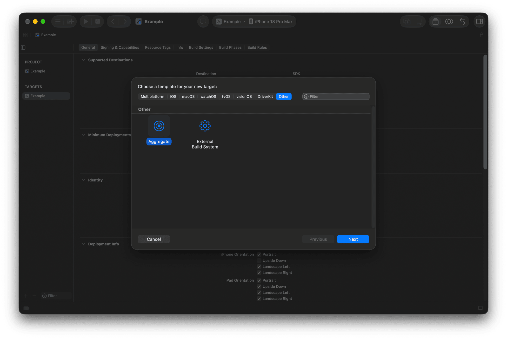
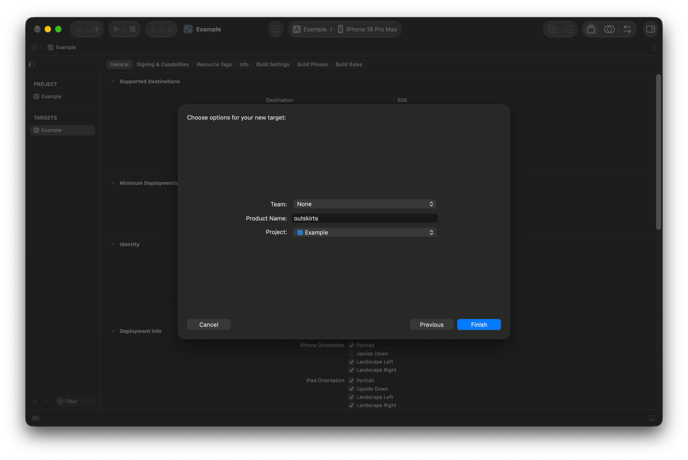
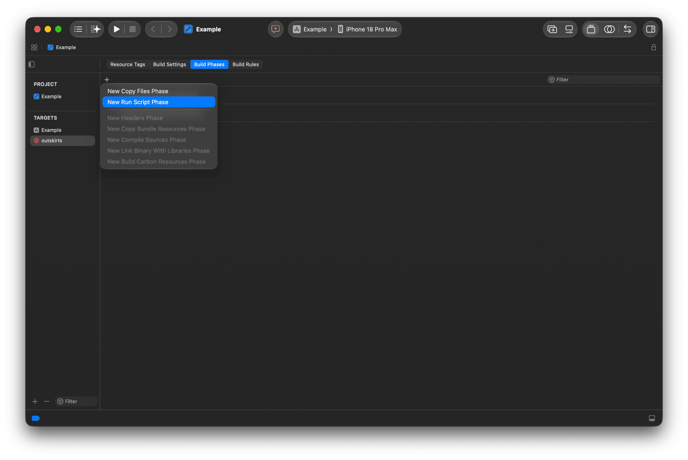
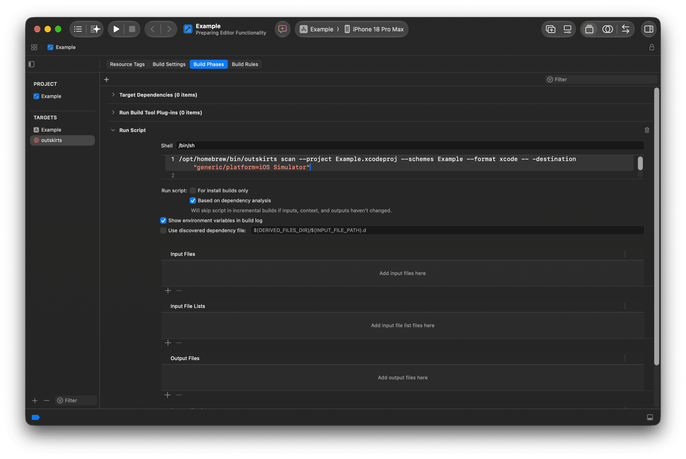
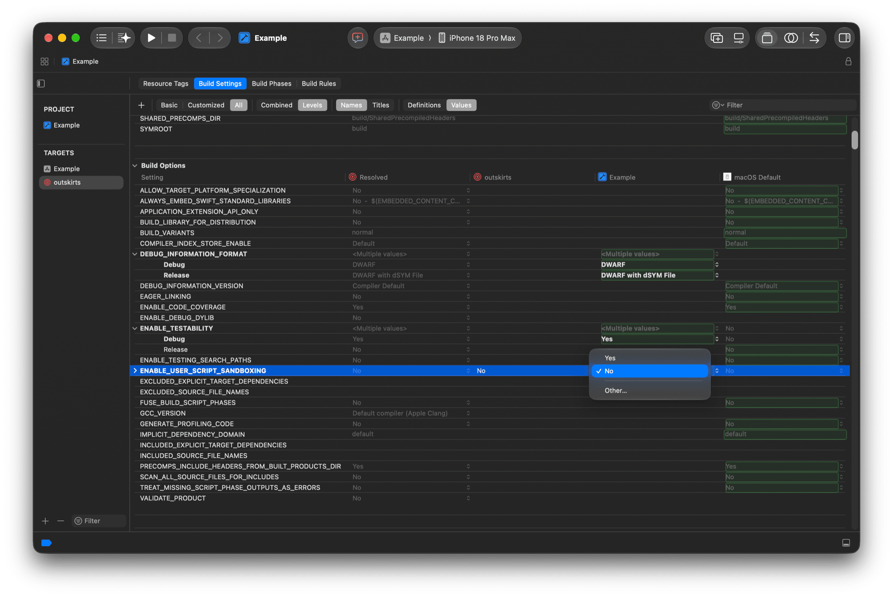
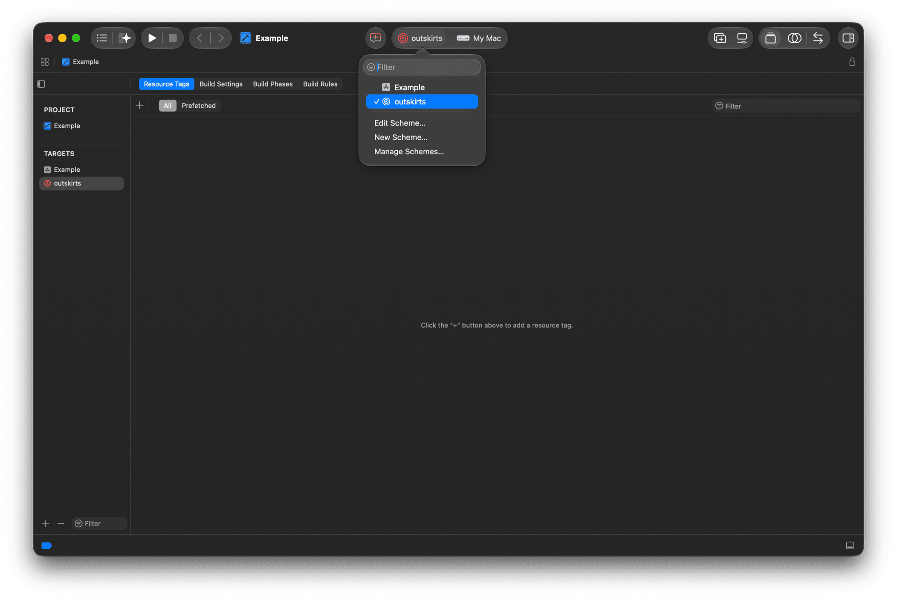

# Xcode integration

Results of the `xcode` format show up as warnings in Xcode, next to the code they point at. This page adds an aggregate target that runs outskirts from a scheme.

Before setting up Xcode integration, get outskirts working in a terminal, as Xcode will run the same command. Your project may need the `-destination` argument of `xcodebuild`; pass it after `--`, e.g. `outskirts scan ... -- -destination "generic/platform=iOS Simulator"`.

## Step 1: Create an aggregate target

Select your project in the Project Navigator and click the + button at the bottom left of the Targets section. Select **Other** and choose **Aggregate**. Click Next.



Choose a name for the new target, e.g. "outskirts" or "Unused Code".



## Step 2: Add a run script build phase

In the **Build Phases** section, click the + button to add a new Run Script phase.



Copy your outskirts command into the script input.

> [!TIP]
> 1. Include the `--format xcode` option so that results are always formatted for Xcode.
> 2. Use the absolute path to `outskirts`.



### Ready-to-paste script

Instead of a bare `outskirts scan` command, this script builds the project itself into a project-local DerivedData with the index store enabled, then scans that index store. Results appear as warnings in Xcode. Edit these parts to match your project:

- `PROJECT`: the path of your `.xcodeproj` relative to `$PROJECT_DIR`. For a workspace, set it to your `.xcworkspace` and replace `-project` with `-workspace` in the `xcodebuild` call.
- `SCHEME`: the scheme to build.
- `DESTINATION`, optionally.
- On the last command, the [options](options.md) your project needs, e.g. `--retain-public` for a framework.

The script does not depend on the default DerivedData location, as it builds into its own folder and passes `--index-store-path`.

```sh
set -eu

PROJECT="MyApp.xcodeproj"
SCHEME="MyApp"
# e.g. "platform=iOS Simulator,name=iPhone 16"
# empty = auto-detect
DESTINATION=""
DERIVED_DATA="$PROJECT_DIR/.build/outskirts-derived-data"

# Locate outskirts (Homebrew: tiny-earth-moon/tap/outskirts)
OUTSKIRTS=""
for candidate in \
  "$(command -v outskirts 2>/dev/null || true)" \
  /opt/homebrew/bin/outskirts \
  /usr/local/bin/outskirts; do
  if [ -n "$candidate" ] && [ -x "$candidate" ]; then
    OUTSKIRTS="$candidate"; break
  fi
done
if [ -z "$OUTSKIRTS" ]; then
  echo "error: outskirts not found, install it:" >&2
  echo "brew install tiny-earth-moon/tap/outskirts" >&2
  exit 1
fi

# Pick the first available iOS simulator,
# else fall back to the generic destination
if [ -z "$DESTINATION" ]; then
  UDID=""
  if command -v python3 >/dev/null 2>&1; then
    UDID="$(xcrun simctl list devices available -j \
      | python3 -c '
import json, sys
devices = json.load(sys.stdin)["devices"]
for runtime, entries in devices.items():
    if "iOS" in runtime:
        for d in entries:
            if d.get("isAvailable", True):
                print(d["udid"]); sys.exit(0)
' || true)"
  fi
  if [ -n "$UDID" ]; then
    DESTINATION="id=$UDID"
  else
    DESTINATION="generic/platform=iOS Simulator"
  fi
fi

# Build with the index store enabled
cd "$PROJECT_DIR"
xcodebuild build \
  -project "$PROJECT" \
  -scheme "$SCHEME" \
  -destination "$DESTINATION" \
  -derivedDataPath "$DERIVED_DATA" \
  COMPILER_INDEX_STORE_ENABLE=YES \
  CODE_SIGNING_ALLOWED=NO

# Scan the index store; the xcode format makes
# results show up as Xcode warnings
"$OUTSKIRTS" scan \
  --skip-build \
  --index-store-path \
    "$DERIVED_DATA/Index.noindex/DataStore" \
  --format xcode
```

`--skip-build` without `--index-store-path` finds the DataStore in DerivedData on its own (since 3.12.2). The shortened form depends on the default DerivedData location: outskirts looks for `~/Library/Developer/Xcode/DerivedData/<ProjectName>-*/Index.noindex/DataStore` (or `Index/DataStore`), using the most recently modified match, so the project must have been built by Xcode there. If it is, the last command can be shortened to:

```sh
"$OUTSKIRTS" scan --skip-build --format xcode
```

## Step 3: Disable user script sandboxing

Disable **User Script Sandboxing** for the Run Script phase: outskirts needs to read your project's index store and source files, which Xcode's default sandbox blocks. Set the `ENABLE_USER_SCRIPT_SANDBOXING` build setting to `No` for the outskirts aggregate target.



## Step 4: Select and run

The new scheme is now in the scheme menu. Select it and run it.

> [!TIP]
> For others on your team to use the scheme, mark it as _Shared_: choose _Manage Schemes..._ and select the _Shared_ checkbox next to the new scheme. The scheme definition can then be checked into source control.


